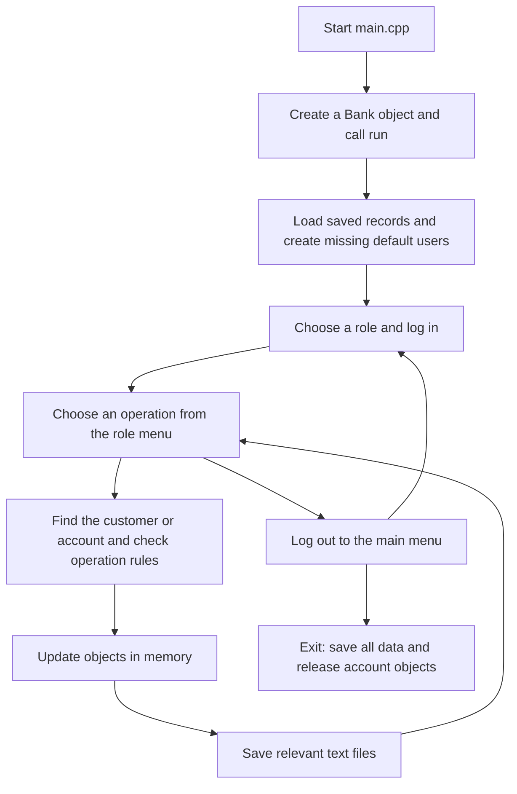

# Banking Management System - C++ OOP Project

This is a **menu-driven banking simulation that runs in a terminal**. You type a menu number, enter the requested details, and the program updates customer accounts, balances, or transaction records.

For example, a manager can open a savings account for a customer with Rs. 5,000. That customer can then log in, deposit Rs. 1,000, and see a balance of Rs. 6,000. The program records the deposit and saves the account balance to a text file.

The project demonstrates **Object-Oriented Programming (OOP)**: organizing code into classes that represent people, accounts, transactions, and loans. It uses local text files for storage. No database server, website, internet banking connection, or real money transfer is involved.

## Key terms

| Term | Meaning in this project |
|---|---|
| Customer | A person registered with the bank, identified by a customer ID such as `C1`. |
| Account | A place where that customer's simulated balance is held, identified by an account number such as `ACC1001`. One customer can have several accounts. |
| Transaction | A record of a successful deposit, withdrawal, or transfer, identified by a number such as `TXN1`. |
| Loan | An application to borrow an amount, identified by a number such as `LOAN1`. |
| EMI | Equated Monthly Instalment: the estimated monthly payment calculated from a loan amount, annual interest rate, and repayment period. |
| Persistence | Saving information so it can be loaded after the program closes. Loan persistence is incomplete in this version. |

**A customer ID and an account number are different.** Use `C1` for customer login or opening an account, and use the generated `ACC...` number for deposits, withdrawals, transfers, and account history.

## What each role can do

The opening menu offers three types of login:

```text
1. Customer Login
2. Employee Login
3. Manager Login
0. Exit
```

| Role | Available menu actions |
|---|---|
| Customer | View profile and linked account numbers; view account details; deposit, withdraw, transfer; view transaction history; apply for and view loans; change password. |
| Employee | Create customers and accounts; view account details; deposit, withdraw, transfer; view transaction history; apply for and view loans; freeze accounts. |
| Manager | All employee-menu operations, plus bank statistics such as customer/account counts, transaction counts, and total account balance. |

Account details and transaction history are looked up by account number. Loans are looked up by customer ID. There is no menu that lists every transaction or every loan at once.

The menus separate roles, but the shared operation functions do **not** check that an account or customer ID entered by a logged-in customer belongs to that customer. Use this as an educational simulation with sample data.

## Set up and run

### 1. Open the CODE folder

On Windows, open PowerShell and enter:

```powershell
cd "C:\Users\aksha\Desktop\placement\Projects\Banking Management System- OOPs\CODE"
dir
```

If your copy is somewhere else, replace the path with your own. Keep quotes around paths containing spaces.

You should see `main.cpp`, `Bank.cpp`, the other `.cpp` and `.h` files, and the five `.txt` data files.

**Run the application from this folder.** Data file paths are relative to the terminal's current directory. Starting the executable from another directory can make it load or create a different set of records.

Before experimenting, copy the five data files somewhere safe if you want to preserve their current contents. The application rewrites them when saving.

### 2. Check for a C++ compiler

A compiler converts the C++ source files into a runnable program. This project needs **C++11 or later** and uses only the C++ standard library.

In PowerShell:

```powershell
g++ --version
```

If a version is printed, continue to compilation.

If Windows cannot find `g++`, one setup option is MSYS2 with its UCRT64 GCC compiler. Install MSYS2 using its [official getting-started guide](https://www.msys2.org/), open **MSYS2 UCRT64**, and run the compiler-install command from that guide:

```bash
pacman -S mingw-w64-ucrt-x86_64-gcc
```

After installation, return to PowerShell. For the default MSYS2 installation location, make its compiler available in the current PowerShell window:

```powershell
$env:Path = "C:\msys64\ucrt64\bin;" + $env:Path
g++ --version
```

Adjust that path if you installed MSYS2 elsewhere. This PATH change applies only to this terminal session.

### 3. Compile all source files together

From the `CODE` folder, run this as one command:

```powershell
g++ -std=c++11 -Wall -Wextra main.cpp Bank.cpp User.cpp Customer.cpp Employee.cpp Manager.cpp Account.cpp SavingsAccount.cpp CurrentAccount.cpp Transaction.cpp Loan.cpp -o BankingManagementSystem.exe
```

- `-std=c++11` enables the language features used in the project.
- `-Wall -Wextra` enables useful compiler warnings.
- The `.cpp` files contain the implementations and must be compiled together.
- `-o BankingManagementSystem.exe` names the output program.

When compilation succeeds, the command returns to the prompt and creates or replaces `BankingManagementSystem.exe`. The folder already includes a Windows executable; rebuilding produces a program from the source files you are reading.

### 4. Launch the program

```powershell
.\BankingManagementSystem.exe
```

Enter menu numbers and press Enter. When asked for an amount, type a number such as `5000` or `5000.50`, without commas or a currency symbol.

Choose **0: Logout** to return from a role menu. Then choose **0: Exit** from the main menu to close normally and save data. Recompile after changing C++ code; otherwise, you can launch the executable directly next time.

### Linux or macOS

With a C++ compiler installed, open a terminal in this same folder:

```bash
g++ -std=c++11 -Wall -Wextra *.cpp -o BankingManagementSystem
./BankingManagementSystem
```

The included `.exe` is a Windows build; compile the source for your own operating system.

## Login credentials and the supplied data

| Role | User ID | Password | Availability |
|---|---|---|---|
| Manager | `M1` | `1234` | Use this for the walkthrough below. The code explicitly supports this default login. |
| Customer | `C1` | `1234` | Present in the supplied customer data; also created if no customers load. |
| Employee | `E1` | `1234` | Created only if no employee records load. The supplied employee file needs the correction described below. |

IDs and passwords are case-sensitive. The startup banner always prints these defaults, even when loaded records differ.

### Why employee login may fail

The bundled `employees.txt` contains a malformed employee row: the fields do not match the loader's expected layout, and the employee is not loaded as an active `E1`. `EMPLOYEE` is a role label, not the intended employee login ID.

You can complete the walkthrough using the manager account. To enable the default employee demo, first close the application and back up `employees.txt`. In a text editor, replace **only its employee row**, leaving the manager row intact, with:

```text
EMPLOYEE|E1|Bank Employee|1234|9876543211|employee@bank.com|EMPLOYEE|1
```

Save the file and restart. Employee login should then use `E1` / `1234`.

The supplied `accounts.txt`, `transactions.txt`, and `loans.txt` are empty, so a first-time user must create an account before trying money operations. The supplied customer record also contains an old `LOAN1` reference; a linked ID by itself does not mean a loan object has been restored.

## First walkthrough: create an account and use it

### 1. Open a savings account as manager

At the main menu, choose **3: Manager Login**, then enter `M1` and `1234`.

In the manager menu, choose **2: Create Account**, then enter:

| Prompt | Example input |
|---|---|
| Customer ID | `C1` |
| Account type | `1` for Savings |
| Initial deposit | `5000` |

The program prints the new account number. With the supplied empty account file, the first account is **`ACC1001`**. If you already have accounts, use the number actually printed.

Creating the account also records its opening deposit as a transaction. You can register another person through **1: Create Customer**; the program asks for a name, password, phone number, and email, then generates a customer ID.

### 2. Log in as the customer

Choose **0** to log out of the manager menu. At the main menu, choose **1: Customer Login**, then enter `C1` and `1234`.

Choose **2: View My Accounts** to see the linked account number. Choose **3: View Account Details** and enter that number to see its type, balance, status, and calculated interest.

### 3. Deposit, withdraw, and view history

Starting with the Rs. 5,000 account above:

| Customer-menu action | Input after selecting it | Expected result |
|---|---|---|
| **4: Deposit Money** | Account number, then `1000` | Balance becomes Rs. 6,000. |
| **5: Withdraw Money** | Account number, then `2000` | Balance becomes Rs. 4,000. |
| **5: Withdraw Money** again | Account number, then `3500` | Rejected because it would leave less than the Rs. 1,000 savings minimum. Balance stays Rs. 4,000. |
| **7: Transaction History** | Account number | Shows the opening deposit, successful deposit, and successful withdrawal. The rejected withdrawal adds no transaction. |

You can check the current balance with **3: View Account Details** after any operation.

### 4. Try a transfer

Log out, return as manager, and create a second account for an existing customer. For example, create another savings account for `C1` with an initial deposit of `2000`.

Choose **6: Transfer Money** in either the manager or customer menu. Enter the first account as sender, the second as receiver, and `500` as the amount.

Following the example above, the first balance becomes Rs. 3,500 and the second becomes Rs. 2,500. History receives two records: `TRANSFER_OUT` for the sender and `TRANSFER_IN` for the receiver.

### 5. Try a loan application

In the customer menu, choose **8: Apply for Loan** and enter your customer ID. Choose a loan type, then enter a positive amount, a positive annual interest percentage, and a positive whole-number tenure in years.

For example: personal loan, amount `12000`, annual rate `12`, tenure `1`.

The program creates a **PENDING** application and displays its estimated monthly EMI. Choose **9: View Loans** and enter the customer ID to inspect it during the same session.

Applying for a loan does not add money to an account. Approval, rejection, disbursement, and repayments are not available through the menus. Loan details are also not restored after restarting; see the storage section below.

### 6. Check statistics and finish

Log in as manager and choose **11: Bank Statistics** to see counts and the sum of account balances.

You can try **10: Freeze Account** on a sample account. Freezing blocks deposits and withdrawals, including transfers involving that account. Its inactive status is saved. **There is no unfreeze option**, so leave this experiment until after the deposit and transfer walkthrough.

Log out with **0**, then exit from the main menu with **0**. Restart and view the account to confirm that its saved balance and transaction history return.

## Account rules

| Rule | Savings account | Current account |
|---|---|---|
| Opening deposit | At least Rs. 1,000 | Any positive amount |
| Withdrawal limit | Must leave at least Rs. 1,000 | Can take the balance down to Rs. -10,000 using the default overdraft limit |
| Interest shown | Current balance multiplied by 4% | Zero |
| Inactive/frozen account | Deposits and withdrawals blocked | Deposits and withdrawals blocked |

An **overdraft** lets a current account balance become negative up to its configured limit. For example, a current account with Rs. 2,000 can withdraw Rs. 12,000 and reach Rs. -10,000.

The savings interest figure is a calculation shown on screen. The program does not automatically credit interest or track an interest-accrual schedule.

Transfers use the sender's withdrawal rules and the receiver's deposit rules. Both accounts must exist and be different. If the receiving deposit fails after the withdrawal, the code attempts to return the amount to the sender.

## What happens inside the program



The `Bank` object coordinates the application. It keeps lists of customers, employees, managers, accounts, transactions, and loans while the program runs. Most successful changes save their relevant files immediately; some changes, such as changing a customer password, rely on a later save, including normal program exit.

For a withdrawal, `Bank::withdraw()` finds the account and calls its `withdraw()` method. The account's actual type decides whether the savings minimum or current-account overdraft rule applies. Only after a successful withdrawal does the bank add a transaction and save the changed data.

## How OOP is used

A **class** describes data and behavior; an **object** is one instance, such as a particular customer or account.

```text
User
|-- Customer
`-- Employee
    `-- Manager

Account (abstract base class)
|-- SavingsAccount
`-- CurrentAccount
```

| OOP concept | Plain-language explanation | Example in this code |
|---|---|---|
| Encapsulation | Keep related data and operations together and control access through methods. | Account balance and status are protected; operations use methods such as `deposit()`, `withdraw()`, and `getBalance()`. |
| Inheritance | Build a specialized class from a more general one. | Customers and employees share `User` fields; a manager extends `Employee`. |
| Abstraction | Define what an object must provide without fixing every implementation. | `Account` has pure virtual `getType()` and `calculateInterest()` methods, so it cannot be instantiated directly. |
| Runtime polymorphism | The same method call behaves differently according to the actual object type. | `Bank` stores `Account*` pointers. Calling `withdraw()` selects the savings or current-account implementation. |
| Object relationships | One object coordinates or refers to several others. | `Bank` manages collections; a `Customer` stores linked account numbers and loan IDs. |

The `Account` destructor is virtual, allowing derived account objects to be deleted through base-class pointers when the bank shuts down.

## Project files and where to start reading

In this project, `.h` files declare each class and its available methods; `.cpp` files implement those methods.

| Files | Responsibility |
|---|---|
| [main.cpp](main.cpp) | Creates the bank and starts the program. |
| [Bank.h](Bank.h), [Bank.cpp](Bank.cpp) | Menus, login, customer/account lookup, banking operations, ID generation, statistics, and file handling. |
| [User.h](User.h), [User.cpp](User.cpp) | Shared identity, login, profile, password, and active-status behavior. |
| [Customer.h](Customer.h), [Customer.cpp](Customer.cpp) | Customer profile and linked account/loan IDs. |
| [Employee.h](Employee.h), [Employee.cpp](Employee.cpp) | Employee designation and profile behavior. |
| [Manager.h](Manager.h), [Manager.cpp](Manager.cpp) | Specialized employee role. |
| [Account.h](Account.h), [Account.cpp](Account.cpp) | Shared balance, account ownership, status, and basic deposit/withdrawal behavior. |
| [SavingsAccount.h](SavingsAccount.h), [SavingsAccount.cpp](SavingsAccount.cpp) | Savings interest and minimum-balance rule. |
| [CurrentAccount.h](CurrentAccount.h), [CurrentAccount.cpp](CurrentAccount.cpp) | Current-account overdraft rule. |
| [Transaction.h](Transaction.h), [Transaction.cpp](Transaction.cpp) | Displaying transactions and converting them to/from text records. |
| [Loan.h](Loan.h), [Loan.cpp](Loan.cpp) | Loan details, EMI calculation, and status methods. |
| `BankingManagementSystem.exe` | Included Windows executable; the compilation command replaces it. |

For a first code walkthrough, read `main.cpp`, then `Bank::run()`, `Bank::initialize()`, and one role menu. Follow `Bank::withdraw()` into `SavingsAccount::withdraw()` and `CurrentAccount::withdraw()` to see the main polymorphism example.

## How data is saved

Each text file contains one record per line. A vertical bar, `|`, separates fields. Customer account and loan ID lists use semicolons, `;`. Avoid these separators in manually entered names or other text fields because there is no escaping mechanism.

| File | Stored data | Reloaded on startup? |
|---|---|---|
| `customers.txt` | ID, name, password, phone, email, active flag, account-number list, loan-ID list | Yes |
| `employees.txt` | Role, ID, name, password, phone, email, designation, active flag; includes managers | Yes |
| `accounts.txt` | Account number, customer ID, type, balance, active flag | Yes |
| `transactions.txt` | Transaction ID, account number, type, amount, date, description | Yes |
| `loans.txt` | Only loan ID, customer ID, and status | **No: loading loan objects is not implemented** |

For example, this account record means an active savings account belonging to customer `C1`, with Rs. 5,000:

```text
ACC1001|C1|SAVINGS|5000.00|1
```

An active flag of `1` means active; `0` means inactive.

**Loan persistence is incomplete:** `saveLoans()` omits the amount, rate, tenure, and type, and `loadLoans()` only opens and closes the file. After restarting, the in-memory loan list is empty even if customer records still refer to loan IDs. The loan ID counter also restarts at `LOAN1`, and a later save overwrites `loans.txt` with the current session's loan list. Do not use this version to preserve loan applications across sessions.

## Current limitations

- Passwords are stored as plain text, and the manager's default credentials are explicitly accepted in code.
- Customer-entered account/customer IDs are not restricted to the logged-in customer's records.
- Loan approval/rejection methods exist in the `Loan` class, but there are no menu actions for them, no repayment workflow, and no complete loan persistence.
- There is no unfreeze menu, employee-registration menu, or automatic interest-crediting process.
- File writes are separate operations without database-style transactions or file locking. Run one instance against a set of data files.
- Money uses floating-point `double` values, so the project does not provide exact decimal accounting.
- No automated test suite is included. The walkthrough above is a manual check of the main account operations.

## Troubleshooting

| Problem | What to do |
|---|---|
| `g++` is not recognized | Install a compiler and ensure its `bin` directory is on PATH. If using the MSYS2 setup above, repeat the session PATH command in a new PowerShell window. |
| Compiler reports undefined references | Compile all the `.cpp` files together, not only `main.cpp`. |
| Compiler cannot replace the executable | Close the running application, then compile again. |
| Executable cannot start because a runtime DLL is missing | Use the compiler's runtime environment/PATH and rebuild locally. Do not assume the included executable matches your installed toolchain. |
| Employee login fails | Follow the supplied employee-record correction above, or use manager login for the demo. |
| Account not found | Create an account first and enter the generated `ACC...` number, not a customer ID such as `C1`. |
| No accounts are listed after customer login | A customer profile does not create an account automatically. Open one through the employee or manager menu. |
| Withdrawal is rejected despite a positive balance | Check the savings minimum, current-account overdraft limit, and whether the account is frozen. |
| Data seems missing after restart | Start from the same `CODE` working directory and check the text files. Missing loan objects are a known implementation limitation. |
| Changes are not saved | Ensure the folder is writable and exit normally. Several save functions return silently if a file cannot be opened. |
| Menu asks again for input | Type the requested number; monetary amounts must be positive and loan tenure must be a positive whole number. |
